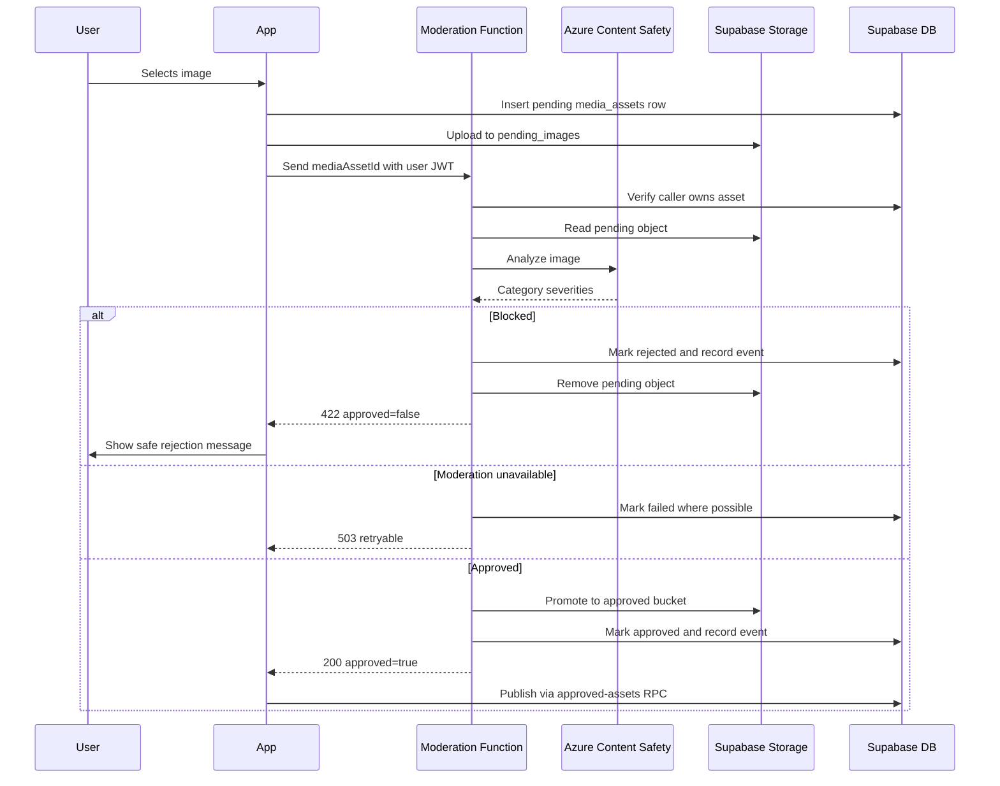

# Diagram: Image moderation sequence

## Purpose

Sequence for moderation-gated uploads.

## Audience

Engineering, safety.

## Current status

Verified for Spot images and profile photos. Profile photos call `set_profile_image_from_approved_asset_v1` instead of the Spot publish RPC.

## Details

## Related docs

- [../engineering/image-moderation.md](../engineering/image-moderation.md)

## Open questions / TODOs

- Add cleanup for unlinked approved and failed assets.
