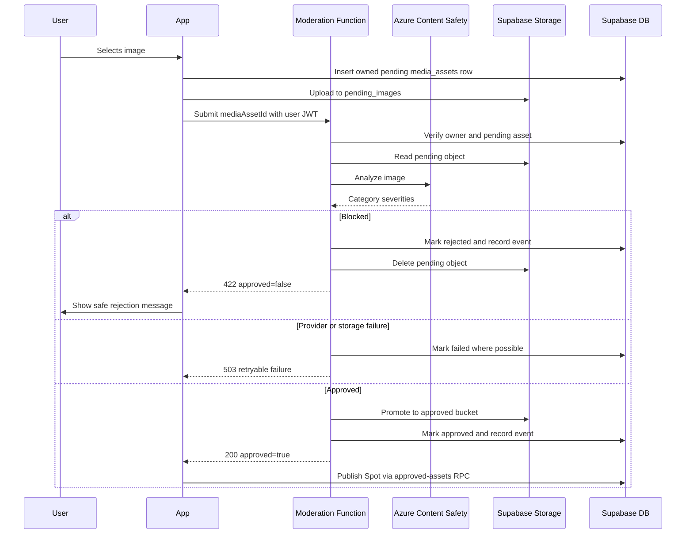

# Image moderation

## Purpose

Requirement and flow: every Spot image and profile image must be moderated before treat-as-approved paths are used.

## Audience

Engineers, safety, review.

## Current status

Spot images and profile photos both go through `supabase/functions/moderate-image/index.ts`. Profile photos use `kind = profile_image`, then `set_profile_image_from_approved_asset_v1` stores a private storage reference.

## Details

### Requirement

**Every** user-uploaded image for **Spots** or **profile pictures** must go through the moderation pipeline tied to `media_assets`—do not bypass with client-only checks.

### Client responsibilities

- Upload to pending storage only for new moderated assets.
- Invoke the function with the owned `mediaAssetId` and await its response.
- Show **safe** rejection messages when blocked.
- Edit Spot replacements use the same pending upload and moderation path. The
  approved replacement remains unlinked until `update_spot_editor_v1` atomically
  applies the editor's final ordered media list; unchanged images are not
  downloaded or re-uploaded.

### Server / function responsibilities

- Validate the caller JWT and `media_assets.owner_id`.
- Call **Azure Content Safety** with server-held credentials.
- Persist scores and outcomes on `media_assets` / `media_moderation_events`.
- Promote approved objects from pending to the appropriate approved bucket.
- Gate final publish on approved status.
- Gate Edit Spot replacement/linking on approved status and ownership. The edit
  RPC accepts existing image row IDs only from the owned Spot and new media
  asset IDs only when they are approved, owned, and not already linked.

### Threshold policy

Default Azure severity thresholds use a 0–6 scale and block at or above:

| Asset kind | Sexual | Violence | Hate | Self-harm |
| --- | ---: | ---: | ---: | ---: |
| `spot_image` | 4 | 4 | 4 | 4 |
| `profile_image` | 2 | 4 | 4 | 4 |

`MODERATION_THRESHOLDS_JSON` can override defaults in the deployed function environment. Policy changes require safety review and tests.

### Block / allow

- **Blocked** — user sees non-graphic explanation; no public approved path.
- **Allowed** — promote to approved bucket paths and allow RPC completion.

The function returns JSON containing `approved: boolean`. Policy rejection returns HTTP 422. Provider, configuration, or Storage failures return retryable HTTP 503. The client intentionally maps these to non-graphic user messages.

### Profile images

`SupabaseUserService.uploadProfileAvatarJPEG` inserts an owned pending `media_assets` row (`kind = profile_image`), uploads the JPEG to `pending_images`, invokes `moderate-image`, and calls `set_profile_image_from_approved_asset_v1`. The RPC rejects anything that is not an approved profile asset owned by the caller. Authenticated clients cannot update `users.profile_image_url` directly.

The stored value is `spot-storage://approved_profile_images/<path>`. `ProfileImageDisplayURL` signs that object for display. Older public `avatars` URLs still display until the user replaces the photo. A provider metadata photo is downloaded and run through the same pipeline instead of being saved as a raw URL.

### Logging

Use `SpotLogger` moderation category and repository logs; avoid logging raw image bytes or PII.

### Sequence (implemented Spot-image path)

## Related docs

- [storage-and-media.md](storage-and-media.md)
- [../diagrams/image-moderation-flow.md](../diagrams/image-moderation-flow.md)
- [environment-variables.md](environment-variables.md)

## Open questions / TODOs

- Add cleanup for approved-but-unlinked and failed media.
- Verify deployed threshold overrides separately in each Supabase environment.
