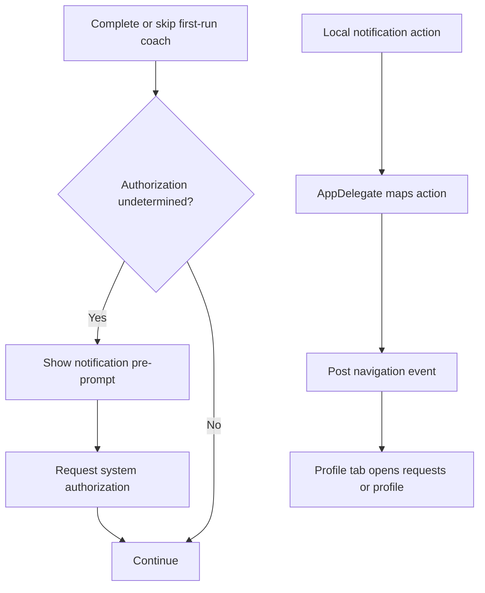

# Notifications

## Purpose

Document notification permission, delivery, action handling, and current production limitations.

## Audience

Engineering, product, QA, and operations.

## Current status

Spot registers UserNotifications categories and schedules local notifications from `FollowActivityMonitor` while the signed-in session is running. It does **not** register for remote notifications, store APNs tokens, or have a push backend. Tapping a follow notification opens Follow Requests or the other person's profile.

## Permission flow

1. The user completes or skips `SpotFirstRunOnboardingManager`.
2. After 600 ms, `BottomTabNavigationView` checks authorization.
3. If status is `.notDetermined`, it presents `NotificationPermissionView`.
4. `PermissionManager` requests system authorization and tracks the result.

Permission is contextual and does not block authentication or the tab shell.

## Registration and delivery

`AppDelegate.application(_:didFinishLaunchingWithOptions:)`:

- calls `NotificationService.shared.registerNotificationCategories()`;
- sets `UNUserNotificationCenter.current().delegate`;
- shows banner, sound, and badge for foreground local notifications.

Registered categories:

| Category | Actions |
| --- | --- |
| `FOLLOW_REQUEST` | Accept, View |
| `FOLLOW_ACCEPTED` | View profile |

`NotificationService` contains helpers for follow-request-received and follow-accepted local notifications.

## Current behavior

### Follow request received

`FollowActivityMonitor` polls pending requests for the signed-in user about every 30 seconds and again when the app becomes active. The first successful poll only records which requests already exist. A request that appears after that baseline schedules `notifyFollowRequestReceived` on this device — the recipient's device.

### Follow request accepted

The monitor remembers the signed-in user's outgoing pending requests. When one disappears and a `follows` row exists, it schedules `notifyFollowRequestAccepted` on the requester's device. A denial is not announced. `FollowRequestsService.accept()` does not schedule a notification on the acceptor's phone.

This still requires the requester's app process to run a poll. Delivery to the lock screen while the app is killed needs APNs.

## Action handling

The `UNUserNotificationCenterDelegate` extension in `Spot/AppDelegate.swift` maps taps/actions to:

- `.navigateToFollowRequests`;
- `.navigateToFollowRequestsAndAccept`;
- `.navigateToProfile`.

`BottomTabNavigationView` observes those events, selects the Profile tab, and `ProfileView` opens Follow Requests (and accepts when the action was Accept) or pushes the named profile. The screen reloads the relationship from Supabase before changing it.

## Security requirements for future push

A production implementation needs:

1. APNs registration and token rotation handling in the app.
2. An RLS-protected device-token table keyed to the authenticated user and installation.
3. Server-triggered delivery after authoritative database changes.
4. Server-held APNs credentials; never a service-role or APNs private key in the client.
5. Generic notification copy that does not expose private content on a lock screen.
6. Token removal on sign-out/account deletion and invalid-token feedback handling.
7. Navigation that revalidates auth, relationship, and content visibility rather than trusting payload IDs.

## Flow

## Testing

Current useful checks:

- complete and skip onboarding paths both offer permission when undetermined;
- category identifiers and action mappings remain stable;
- foreground local delivery uses banner, sound, and badge;
- denied authorization does not block app use.

`FollowActivityDiff` covers which events are new after a baseline. Do not describe that as APNs delivery while the app is killed.

## Known limitations

- Local notifications only; no APNs device-token registration or backend. Alerts fire when this device polls, including the next time the app becomes active.
- No notification preference UI or notification history.

## Related docs

- [runtime-flows.md](runtime-flows.md)
- [networking-and-auth.md](networking-and-auth.md)
- [../product/onboarding.md](../product/onboarding.md)
- [../product/profiles-and-social.md](../product/profiles-and-social.md)
